# Editing your portfolio

Kashish, this guide is for you. You can change every word, image, colour and project on your site from a web browser, without touching any code. Your site has a private editor at **yoursite/admin** (for example `https://kashish-khera.netlify.app/admin`).

When you press **Publish** in the editor, your change is saved to your GitHub account and the live site updates by itself in **about a minute**.

**Contents**

1. [One-time setup (done once by whoever sets up the site)](#1-one-time-setup-done-once-by-whoever-sets-up-the-site)
2. [Logging in](#2-logging-in)
3. [Changing the landing page](#3-changing-the-landing-page)
4. [Contact details, social links and your CV](#4-contact-details-social-links-and-your-cv)
5. [Changing the site colours](#5-changing-the-site-colours)
6. [Editing a project](#6-editing-a-project)
7. [Adding a new project](#7-adding-a-new-project)
8. [Reordering the folders](#8-reordering-the-folders)
9. [Coming soon or published](#9-coming-soon-or-published)
10. [Importing a whole folder of images from Google Drive](#10-importing-a-whole-folder-of-images-from-google-drive)
11. [Troubleshooting](#11-troubleshooting)


---

## 1. One-time setup (done once by whoever sets up the site)

This connects three things: **GitHub** (where your site's files live, in *your* account, so you own it permanently), **Netlify** (which publishes it and handles the editor login), and the **editor** at `/admin`.

### a. Put the site in Kashish's GitHub account

1. Kashish creates a free GitHub account at https://github.com if she doesn't have one, and shares her username with whoever is setting up the site.
2. The site helper creates a new **private or public** repository in **her** account called `kashish-portfolio` (or she creates it and adds her helper as a collaborator under *Settings → Collaborators*).
3. Push this folder to it, on the `main` branch.

### b. Tell the editor which repository to use

Open `admin/config.yml` (on GitHub you can click the file, then the pencil icon) and change this line:

```yaml
  repo: "[HER-GITHUB-USERNAME]/kashish-portfolio"
```

to her real username, for example:

```yaml
  repo: "kashishkhera/kashish-portfolio"
```

Commit the change.

### c. Publish the site on Netlify

1. Log in at https://app.netlify.com (Kashish can sign up with her GitHub account).
2. **Add new site → Import an existing project → GitHub**, and pick `kashish-portfolio`.
3. The settings are read from `netlify.toml` automatically (build command `npm run build`, publish directory `.`). Click **Deploy**.
4. Optional: **Site configuration → Domain management** to rename the address (for example `kashish-khera.netlify.app`) or add your own domain.

### d. Let the editor log in with GitHub (Netlify OAuth)

The editor logs you in through GitHub, with Netlify acting as the go-between.

1. **On GitHub** (signed in as Kashish): click your profile picture → **Settings → Developer settings → OAuth Apps → New OAuth App**.
   - **Application name:** `Kashish portfolio editor`
   - **Homepage URL:** your Netlify address, e.g. `https://kashish-khera.netlify.app`
   - **Authorization callback URL:** `https://api.netlify.com/auth/done` (exactly this)
   - Click **Register application**. Copy the **Client ID**, then click **Generate a new client secret** and copy the secret.
2. **On Netlify:** open the site → **Site configuration → Access & security → OAuth**. Under **Authentication providers** click **Install provider**, choose **GitHub**, paste the **Client ID** and **Client secret**, and click **Install**.
3. Visit `https://<your-site>/admin` and click **Login with GitHub**. Done.

### e. Get contact form messages by email

Messages from the **Get in Touch** form are collected by Netlify. To have them emailed to you: Netlify → your site → **Forms** → **Form notifications** → **Add notification → Email notification**, and enter your email address.

---

## 2. Logging in

Go to **yoursite/admin** and click **Login with GitHub**. The first time, GitHub asks you to authorise the app; click **Authorize**.

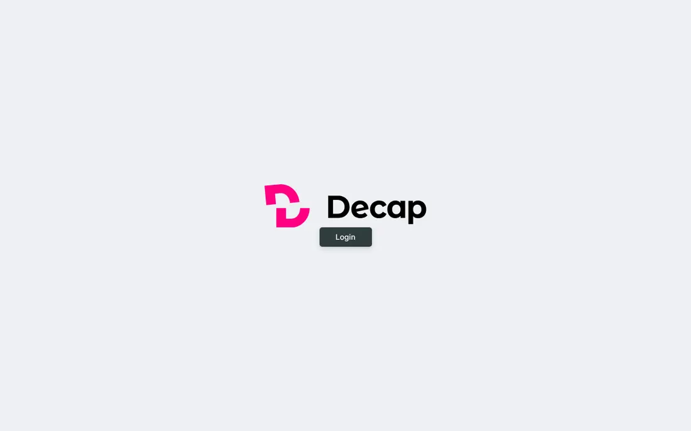

You'll see two collections on the left:

- **Site settings**: your name, landing page, contact details, CV and colours.
- **Projects**: one entry per folder on the site.

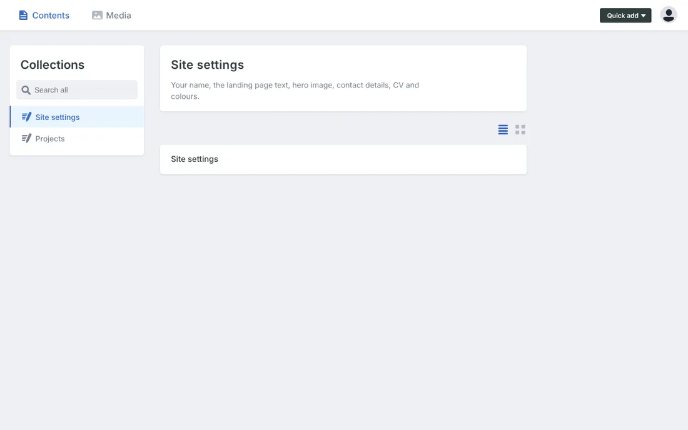

**How saving works:** make your changes, then click **Publish** at the top and choose **Publish now**. Wait about a minute, then refresh your site. The right-hand side of the editor is a rough preview; the real design only shows on the live site.

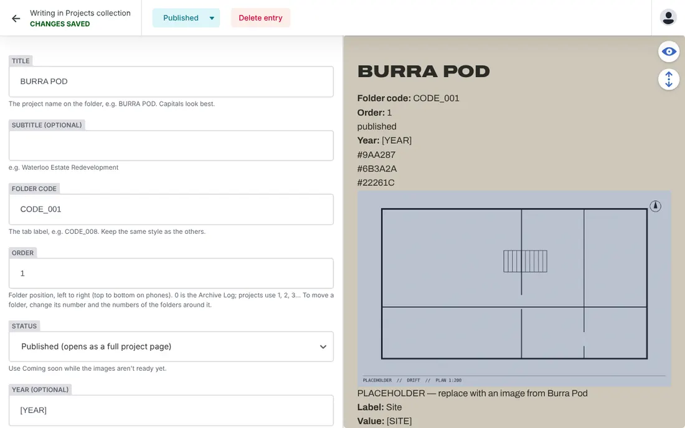

> **Don't type square brackets** `[ ]` anywhere in your text. The site uses them to mark unfinished information, so a publish that contains one is stopped on purpose and the live site keeps its previous version (see [Troubleshooting](#11-troubleshooting)). If you haven't got something yet, leave the field empty instead.

---

## 3. Changing the landing page

**Site settings → Site settings.**

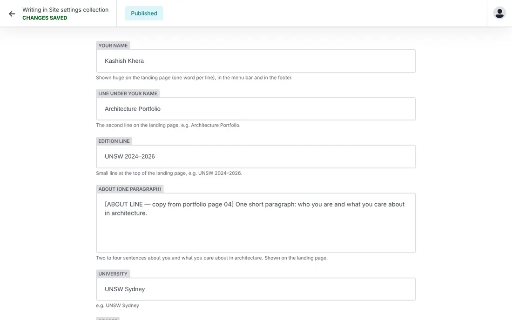

- **Your name** is shown huge on the landing page, one word per line, and in the menu bar and footer.
- **Line under your name** is "Architecture Portfolio". Its last word is set in a handwritten script, so "Architecture *Portfolio*".
- **Edition line** is the small line at the top (e.g. `UNSW 2024-2026`).
- **About** is your one-paragraph introduction. Two to four sentences is plenty. Leave it empty and the landing page simply shows your name, the line under it and your degree.
- **University**, **Degree** and **Years of study** appear in small capitals above the about paragraph.

### Swap the hero image

Scroll to **Hero image (landing page)**. Click **Choose different image**, then **Upload**, pick your file, and click **Choose selected**. Write one plain sentence in **Describe the image** (this is read aloud to people using screen readers, e.g. *Pencil sketch of a curved concrete pavilion*).

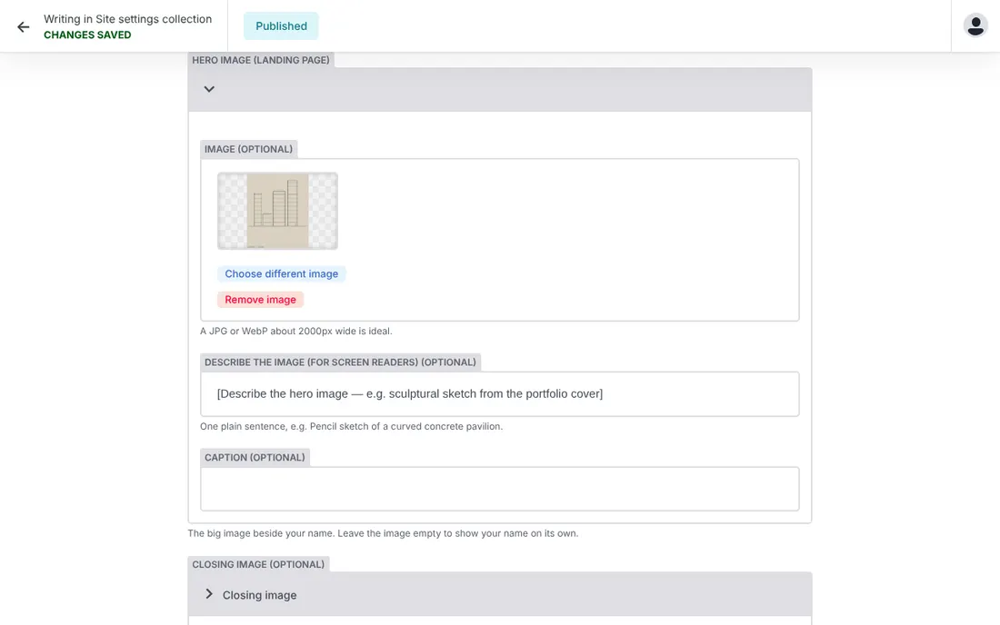

Tips:

- A JPG or WebP about **2000px wide** is ideal. Very large photos (over about 3MB) make the site slow; export a smaller copy first.
- Until you add a hero image, the landing page shows an empty frame with a thin outline in its place. Click **Remove image** to go back to that frame.
- The hero has no frame: it runs off the right-hand edge of the screen, as if cut from your page, and its paper blends into the background. Use **Look: Drawing on paper** for sketches (the default), or *Photo or dark image* for a photo.

---

## 4. Contact details, social links and your CV

Still in **Site settings**, scroll down.

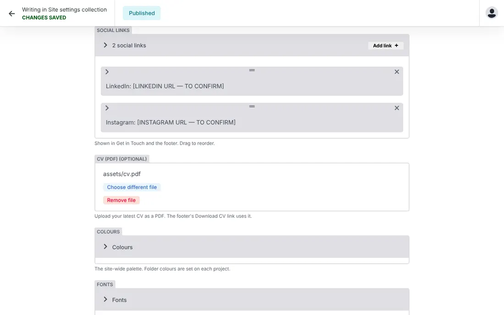

- **Get in Touch: intro sentence** sits above your email address.
- **Email** is shown large in the Get in Touch section, and is offered as a fallback if the contact form ever fails.
- **Phone** is optional. Leave it empty to hide it.
- **Location** appears in the footer.
- **Social links:** click a link to edit it, **Add link** for a new one, or drag the ═ handle to reorder. Use the full address starting with `https://`.

### Replace your CV

In **CV (PDF)**, click **Choose different file → Upload**, pick your new PDF, then **Choose selected** and **Publish**. The **Download CV (PDF)** link in the footer uses this file.

---

## 5. Changing the site colours

**Site settings → Colours** (click the arrow to open it). Click a colour swatch to pick a new colour, or type a hex code like `#B08A5B`.

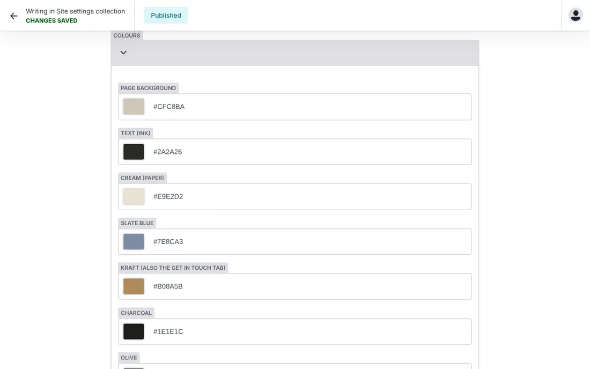

These change the whole site: the page background, text, and the shared palette. **Kraft** is also the colour of the tab on the Get in Touch section. Each project's own folder colours are set on the project itself (next section).

Keep the **Text (ink)** colour dark and the **Page background** light, so everything stays easy to read.

---

## 6. Editing a project

Click **Projects**. Use **Sort by → Order** to see them in the same order as the folders on the site.

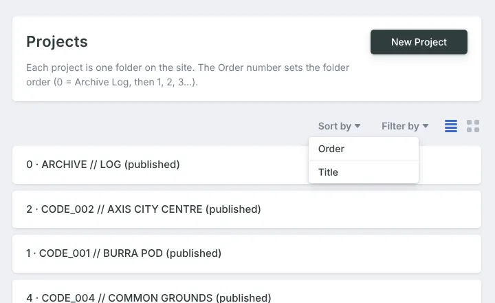

Click a project to open it.


- **Title** is the name on the folder (capitals look best).
- **Subtitle** is optional, e.g. *Waterloo Estate Redevelopment*.
- **Folder code** is the tab label, e.g. `CODE_004`.
- **Order**: see [Reordering the folders](#8-reordering-the-folders).
- **Status**: see [Coming soon or published](#9-coming-soon-or-published).

### Change a folder's colours

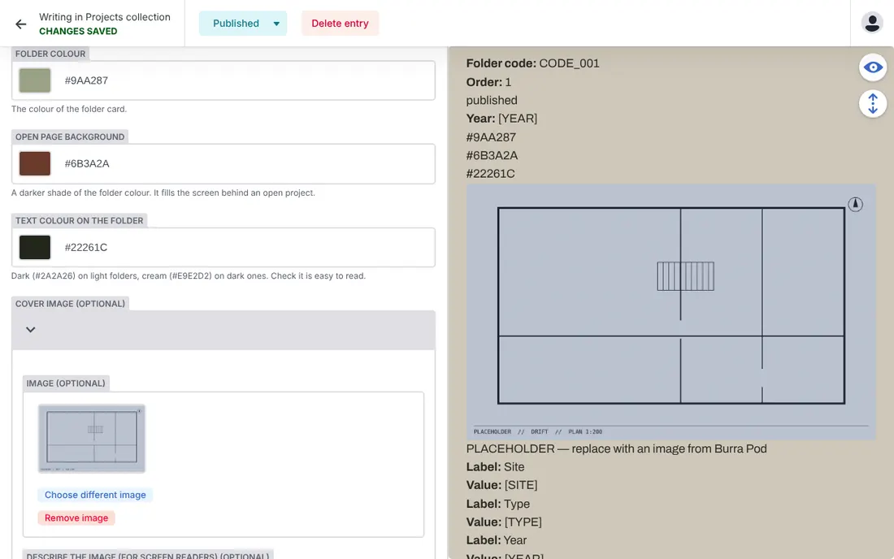

- **Folder colour** is the folder card itself.
- **Open page background** fills the screen behind the project when it's open. Use a darker shade of the folder colour.
- **Text colour on the folder:** dark (`#2A2A26`) on light folders, cream (`#E9E2D2`) on dark ones. Check it's easy to read.

### Swap an image

Every image field works the same way: **Choose different image → Upload → Choose selected**. Each project has its own image folder, so the library only shows that project's images.

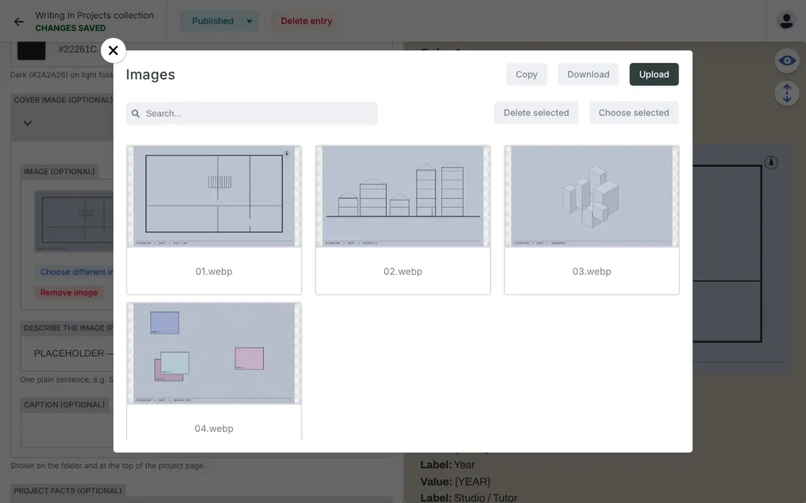

- The **Cover image** is shown on the folder and at the top of the project page.
- Always fill in **Describe the image**.
- **Look** (on every image): choose *Drawing on paper* for scans and sketches. The white or grey of the scanned paper melts into the page colour, so the drawing looks laid straight onto the paper. Choose *Photo or dark image* for photos, renders and dark pages, which are shown exactly as they are.
- **Maximum width (px)** is optional. If an image is small or blurry when shown large, type its real width (e.g. `900`) so it's never stretched beyond that. Leave it empty for normal images.
- Export drawings and renders at **2400px wide or more** so plans stay crisp.
- If you see the same picture as `01.webp`, `01-800.webp`, `01-1600.webp` and `01-2400.webp`, those are sizes made by the import script: pick the plain `01.webp`.

### Facts and statement

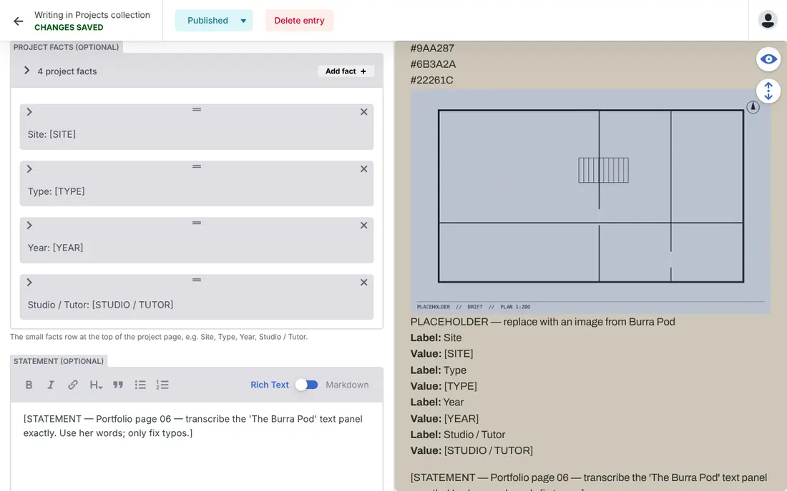

- **Project facts** is the small row at the top of the project page (Site, Type, Year, Studio / Tutor). Click one to edit it, or **Add fact**.
- **Statement** is your project text. Use the toolbar for **bold**, *italic*, links and lists.

### The gallery (the rest of the project page)

The gallery is the project page from top to bottom. Click a section's arrow to open it, the **×** to remove it, or drag the ═ handle to move it.

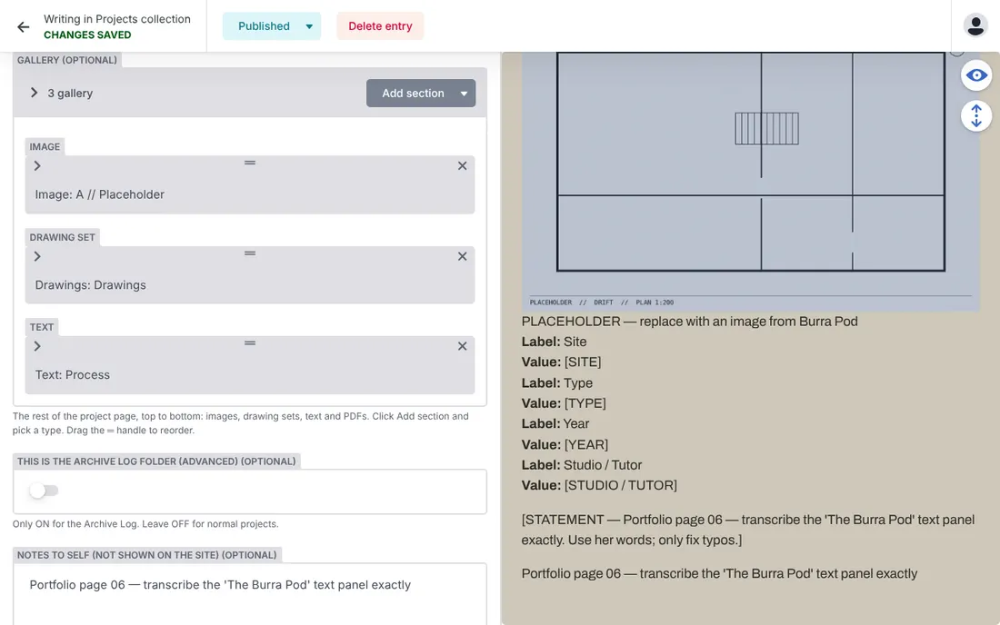

Click **Add section** and choose a type:

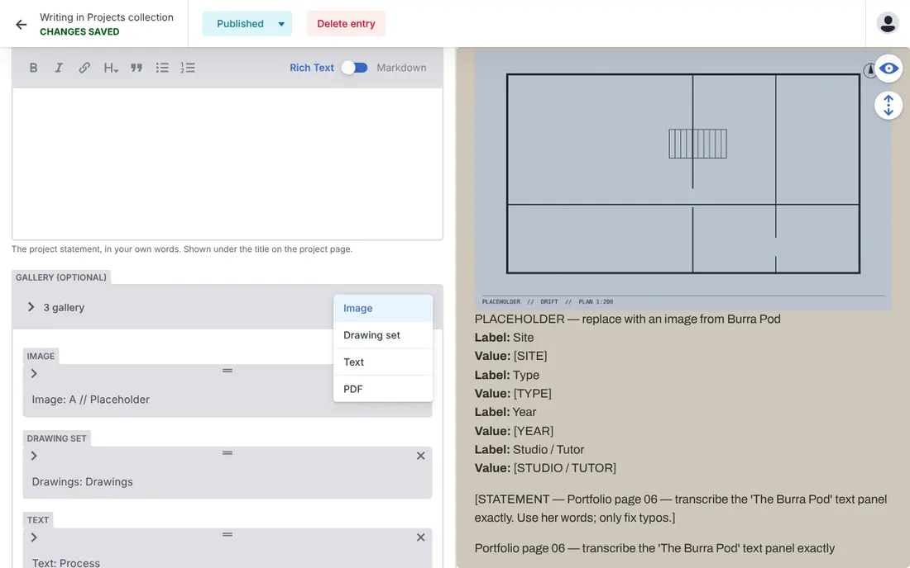

| Type | What it's for | Settings |
|---|---|---|
| **Image** | One render, photo or drawing | **Size**: *Full* (inside the margins), *Bleed* (edge to edge), *Two-thirds* or *Half* (two side by side). **Align**: *Left* or *Right*, for Two-thirds and Half images |
| **Drawing set** | A grid of plans, sections or elevations | **Columns**: 1, 2 or 3, then add each drawing with its caption |
| **Text** | A heading and a paragraph, e.g. *Process* | Written like the statement |
| **PDF** | A process book or report people can open | Upload the PDF and give it a title |

Captions in the style `A // Ground floor plan, 1:200` match the rest of the site.

---

## 7. Adding a new project

In **Projects**, click **New Project**.

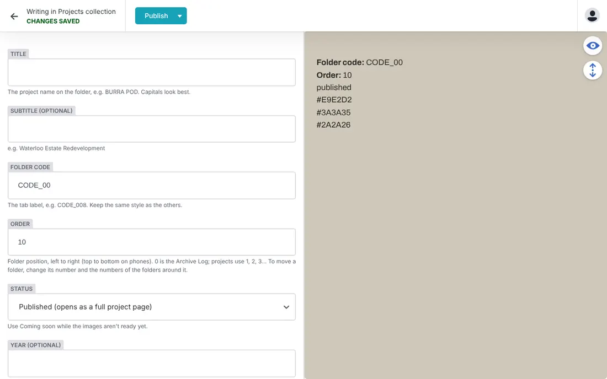

1. Fill in the **Title**, **Folder code** (the next number, e.g. `CODE_008`) and **Order**.
2. Pick the three colours.
3. Add a **Cover image**, **Project facts**, a **Statement** and your **Gallery** sections.
4. Click **Publish → Publish now**.

The web address of the project is made from the title (e.g. *Burra Pod* becomes `#project/burra-pod`).

To remove a project for good, open it and click **Delete entry**. (To hide it for a while instead, set it to **Coming soon**.)

---

## 8. Reordering the folders

Folders are arranged by their **Order** number: left to right on computers, top to bottom on phones. `0` is always the **Archive Log**; projects use `1, 2, 3…`.

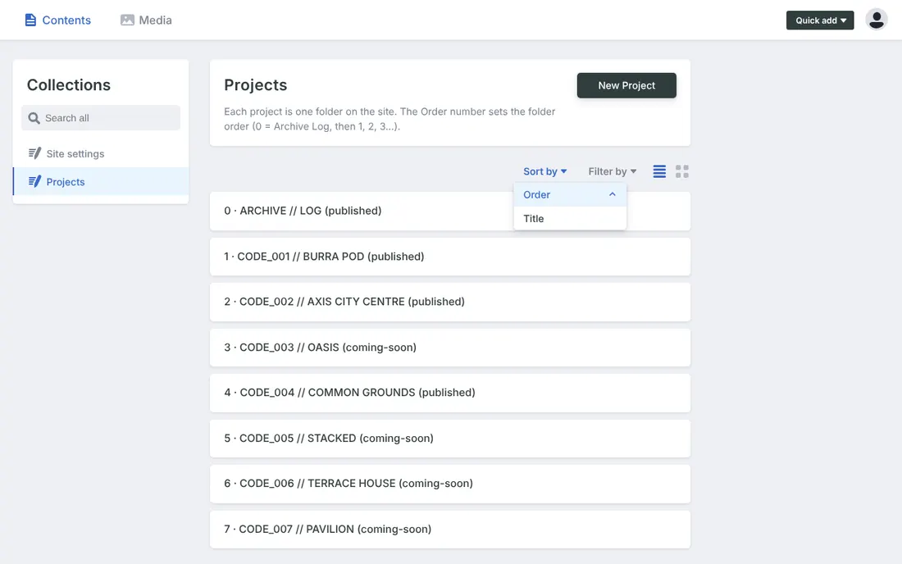

To move a folder, change its number and the numbers of the folders around it. For example, to put Oasis (3) before Axis City Centre (2), give Oasis `2` and Axis City Centre `3`, then publish both.

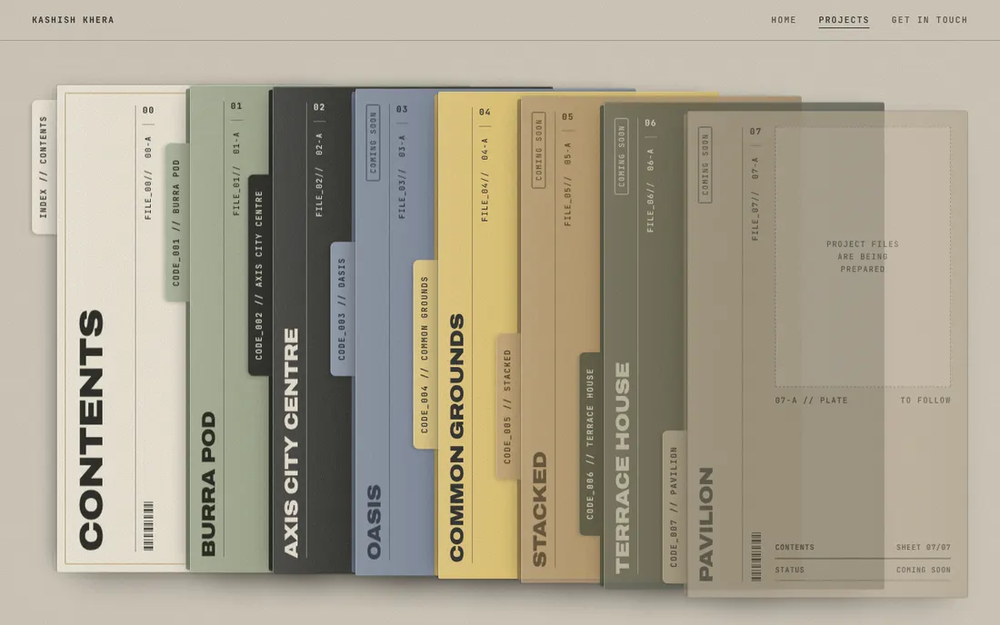

---

## 9. Coming soon or published

Each project has a **Status**:

- **Published**: the folder opens into a full project page.
- **Coming soon**: the folder is shown, marked as coming soon, while you're still preparing the images.

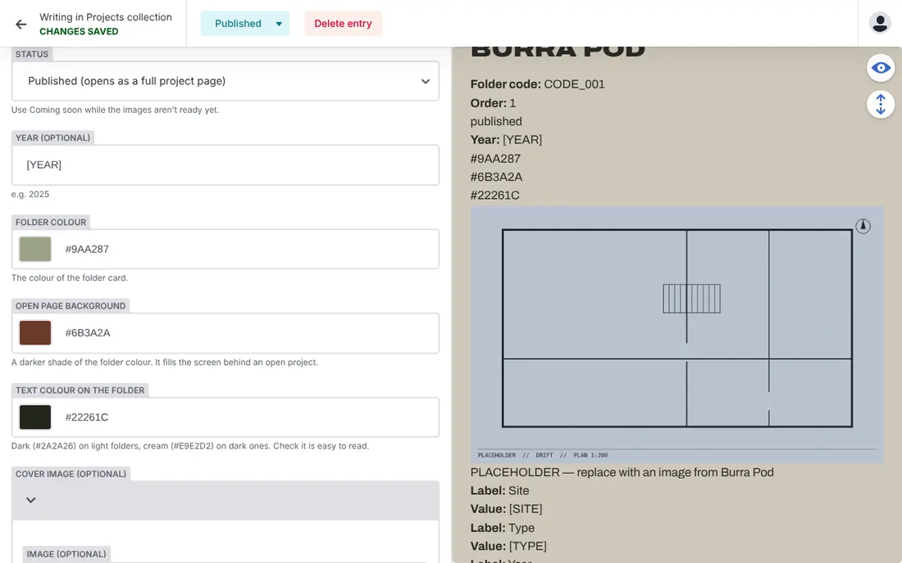

When a project's images and text are ready, switch it to **Published** and click **Publish → Publish now**.

---

## 10. Importing a whole folder of images from Google Drive

For a project with lots of images, the import script is quicker than uploading one by one. It turns a folder of raw images (any size, JPG/PNG/TIFF/HEIC…) into web-ready images at 2400, 1600 and 800px, and writes a starting project file with every image listed in order. Your site helper can run this for you, or you can with [Node.js](https://nodejs.org) installed.

1. Download the project's folder from Google Drive and unzip it, e.g. into `her-drive/oasis`. Name the files in the order you want them (`01 site plan.jpg`, `02 section.jpg`…).
2. In the site folder, run:

   ```bash
   npm install
   npm run import -- her-drive/oasis oasis
   ```

   The first part is the folder of images; the second is the project's short name (lowercase, hyphens, e.g. `terrace-house`). The images go into `assets/projects/oasis/`.
3. If the project is new, the script writes `content/projects/oasis.md`. If the project already exists, it prints the gallery list so it can be pasted in, and leaves your file alone.
4. Commit and push the changes to GitHub (for example with GitHub Desktop). Netlify publishes them.
5. Back in the editor, open the project to write the alt text and captions, choose the cover, and set it to **Published**.

---

## 11. Troubleshooting

**I pressed Publish but the site hasn't changed.**
Wait a minute, then refresh. Your browser may be showing an old copy, so try a hard refresh (Ctrl+Shift+R, or Cmd+Shift+R on a Mac). Still nothing? In Netlify, open your site's **Deploys** page. A failed deploy shows in red with the reason; the most common one is a project file with a mistake in its settings, which the build log names.

**The login button does nothing, or says "Not Found" or "Failed to authenticate".**
Check that the GitHub provider is installed in Netlify (section 1d), that the callback URL in the GitHub OAuth App is exactly `https://api.netlify.com/auth/done`, and that the `repo:` line in `admin/config.yml` has your real username. Log in from your live Netlify address, not from a preview link.

**"Your GitHub user account does not have access to this repo."**
Log in with the GitHub account that owns the repository, or ask the owner to add you under **Settings → Collaborators**.

**An image doesn't appear on the site.**
Make sure you clicked **Choose selected** after uploading, then **Publish**. Check that the file is a JPG, PNG or WebP (not HEIC); export a JPG from Photos if needed.

**The contact form says the message could not be sent.**
On your computer (not the live site) this is expected: the form only works once the site is on Netlify. On the live site, check **Forms** in Netlify is enabled.

**Netlify says the deploy failed and mentions a "[".**
Somewhere in your text there's a square bracket, which marks unfinished information. The build log names the file. Find it in the editor, replace or remove the bracketed text, and publish again.

**I made a mistake.**
Every Publish is saved as a version on GitHub, so nothing is lost. Your site helper can restore an earlier version from the repository's history.

### Editing on your own computer (optional)

With the site folder on your computer: run `npm run dev` in one terminal and `npm run cms` (which starts `npx decap-server`) in another, then open http://localhost:8000/admin/. Changes are saved straight to the files on your computer, with no login. Push them to GitHub when you're happy.
